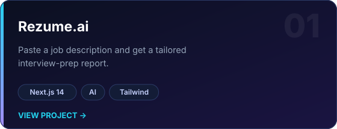
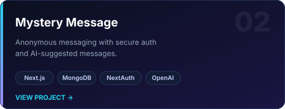
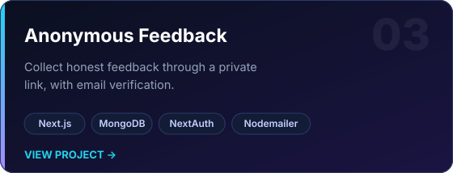
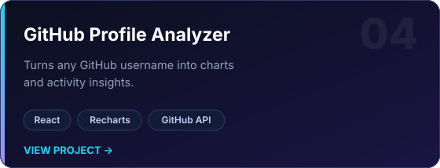
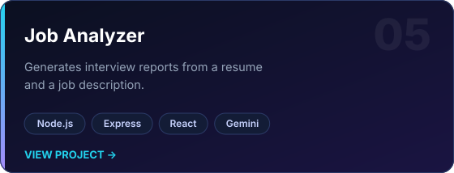
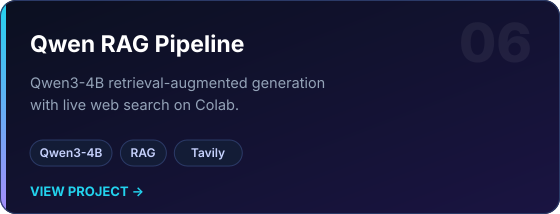

  

  
  
  

  CS&E student at <b>Sylhet Engineering College</b> · Sylhet, Bangladesh 
  Available <b>20-30 hrs/week</b> for internships and project-based work

---

<h2 align="center">Featured Work</h2>

<table>
  <tr>
    <td width="50%"> <a href="LIVE-URL">Live demo</a> · <a href="https://github.com/tithy-ghosh/REPO-NAME">Source</a></td>
    <td width="50%"> <a href="LIVE-URL">Live demo</a> · <a href="https://github.com/tithy-ghosh/REPO-NAME">Source</a></td>
  </tr>
  <tr>
    <td width="50%"> <a href="LIVE-URL">Live demo</a> · <a href="https://github.com/tithy-ghosh/REPO-NAME">Source</a></td>
    <td width="50%"> <a href="LIVE-URL">Live demo</a> · <a href="https://github.com/tithy-ghosh/REPO-NAME">Source</a></td>
  </tr>
  <tr>
    <td width="50%"> <a href="LIVE-URL">Live demo</a> · <a href="https://github.com/tithy-ghosh/REPO-NAME">Source</a></td>
    <td width="50%"> <a href="https://github.com/tithy-ghosh/REPO-NAME">Source</a></td>
  </tr>
</table>

---

<h2 align="center">Tech I Build With</h2>

  

  Frontend · Backend · Databases · AI / LLM APIs (OpenAI, Gemini) · RAG pipelines

---

